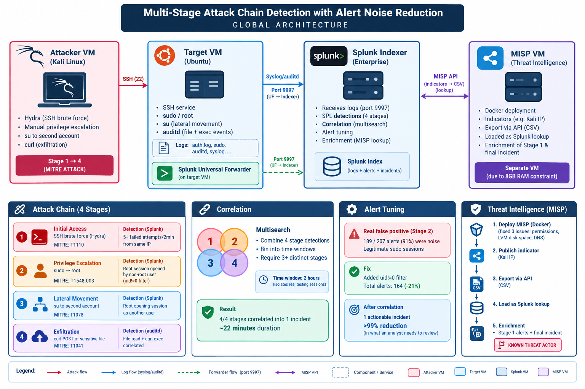

# Multi-Stage Attack Chain Detection with Alert Noise Reduction

A Splunk-based detection lab that reproduces a realistic 4-stage attack, detects each stage, correlates them into a single incident, reduces alert noise, and enriches the result with threat intelligence from MISP.

Built during an internship at Duo Link (Casablanca), summer 2026.

## The idea

Real attackers do not execute one isolated action: they execute a chain. Most detection setups look for single techniques, so an analyst only sees disconnected fragments of the same attack. If the attacker operates as a chain, detection has to operate as a chain too. This project detects each link, then rebuilds the chain itself.

## Attack chain

| Stage | Technique simulated | MITRE ATT&CK | Log source |
|---|---|---|---|
| 1. Initial access | SSH brute force (Hydra) | T1110 | auth.log |
| 2. Privilege escalation | `sudo su` to root | T1548.003 | auth.log |
| 3. Lateral movement | `su` pivot to a second account | T1078 | auth.log |
| 4. Exfiltration | `curl` POST of a sensitive file | T1041 | auditd |

## Architecture



Four virtual machines: Kali Linux (attacker), an Ubuntu target with the Splunk Universal Forwarder and auditd, a Splunk Enterprise indexer, and a separate MISP instance (Docker).

## Results

| Metric | Result |
|---|---|
| Stages detected and correlated | 4 / 4 |
| Incident duration (first to last event) | ~22 minutes |
| Raw alerts after tuning | 207 -> 164 (-21%) |
| Stage 2 alerts that were noise before tuning | 189 of 207 (91%) |
| Alerts shown to the analyst after correlation | 164 raw alerts -> 1 incident (>99% reduction) |
| Threat intelligence | Attacker IP flagged as a known threat actor via MISP |

Counts were measured at the time of testing and will vary with your own data.

## Repository structure

``````
detection-rules/    One Splunk search per attack stage
correlation/        Multi-stage correlation + MISP enrichment
tuning/             Alert-volume baseline used to measure noise reduction
threat-intel/       Stage 1 detection enriched with MISP indicators
architecture.png    Lab architecture diagram
``````

## How it works

1. Each stage has its own detection rule that extracts fields with `rex` and tags the event with `attack_stage` and `mitre_technique`.
2. The correlation search merges the four detections with `multisearch`, buckets events into 2-hour windows, and declares an incident when at least 3 distinct stages appear in the same window.
3. A CSV export of MISP indicators is loaded as a Splunk lookup. Any alert whose source IP matches an indicator is flagged as a known threat actor.

## Setup notes

**Forwarder inputs (`inputs.conf` on the target):**

``````
[monitor:///var/log/auth.log]
index = main

[monitor:///var/log/audit/audit.log]
sourcetype = linux_audit
index = main
``````

**auditd rules (Stage 4):**

``````
-w /etc/secret_data.txt -p r -k sensitive_file_access
-a always,exit -F arch=b64 -S execve -F exe=/usr/bin/curl -k curl_exec
``````

**MISP lookup:** export the indicators as CSV through the MISP REST API (`/attributes/restSearch/type:ip-src/returnFormat:csv`, using your own API key), upload the file in Splunk as `misp_indicators.csv`, and share it with all apps.

## Key findings

- A detection rule taken alone can be extremely noisy: the privilege-escalation rule initially counted every legitimate `sudo` session. A `uid != 0` filter removed part of the noise, but a single escalation event cannot be told apart from normal admin activity without context.
- Correlation is what removes most of the noise, because it turns hundreds of raw alerts into one incident with a clear sequence.
- Network-based detection of the exfiltration (Snort) was abandoned after configuration issues, and replaced by host-based detection with auditd.

## Limitations

- Lateral movement is simulated on a single host (a pivot between local accounts) because of hardware limits (8 GB of RAM).
- MISP was fed manually with a single indicator, with no external threat feed.
- The correlation window (2 hours) is a fixed value, not adaptive.

## Disclaimer

This is an educational lab. Every attack technique was run only against virtual machines owned by the author, on an isolated private network. Do not run these techniques against any system you do not own or do not have explicit authorization to test.

## Author

Ahmed Houachmi, 5th-year engineering student (Cybersecurity and Networks), EMSI Casablanca.
LinkedIn: https://www.linkedin.com/in/a-houachmi/
